# NuevaMente

Convierte documentación técnica extensa en material educativo adaptado a un perfil y a un formato, anclado a la fuente original (RAG + Gemini).

Proyecto del equipo 45 (G10-LATAM) — Hackathon ONE G10-LATAM (Oracle Next Education & Alura).

## Índice

1. [Descripción](#1-descripción)
2. [Características principales](#2-características-principales)
3. [Arquitectura y tecnologías](#3-arquitectura-y-tecnologías)
4. [Instalación y ejecución](#4-instalación-y-ejecución)
5. [Uso de la API](#5-uso-de-la-api)
6. [Calidad y pruebas](#6-calidad-y-pruebas)
7. [Limitaciones conocidas](#7-limitaciones-conocidas)
8. [Próximos pasos](#8-próximos-pasos)
9. [Estructura del proyecto](#9-estructura-del-proyecto)
10. [Equipo](#10-equipo)
11. [Cumplimiento de requisitos](#11-cumplimiento-de-requisitos)
12. [Recursos opcionales cubiertos](#12-recursos-opcionales-cubiertos)

Documentación técnica complementaria:

- [docs/arquitectura.md](docs/arquitectura.md) — flujo RAG paso por paso, parámetros y decisiones por capa.
- [docs/fidelidad.md](docs/fidelidad.md) — cómo se calcula el puntaje de fidelidad, qué mide y qué no.
- [docs/fallback.md](docs/fallback.md) — cadena de modelos de Gemini, errores que disparan el respaldo y tiempos.
- [docs/test_plan.md](docs/test_plan.md) — plan de pruebas (casos automatizados y manuales).

## 1. Descripción

**Problema.** La documentación técnica (manuales, guías de arquitectura, referencias) suele ser larga y densa: cuesta asimilarla, y adaptarla a otra audiencia es un trabajo manual que consume tiempo de especialistas.

**Solución.** NuevaMente recibe un documento (PDF, Markdown o texto), un perfil de destinatario y un formato de salida, y devuelve material educativo estructurado generado a partir de los fragmentos más relevantes del propio documento. Además calcula un puntaje de fidelidad que indica qué tan anclado a la fuente está lo generado.

**Valor.** Menos tiempo para preparar material de estudio, contenido adaptado al nivel de quien lo lee y una señal explícita de cuándo conviene revisarlo.

**Público objetivo.** Quienes necesitan estudiar o enseñar a partir de documentación técnica: personas en transición de carrera hacia tecnología (perfil *Principiante*) y líderes técnicos o arquitectos que quieren ir directo a las decisiones de diseño (perfil *Líder técnico / Arquitecto*).

## 2. Características principales

- **2 perfiles × 2 formatos.** Perfiles: `Principiante` y `Lider Tecnico / Arquitecto`. Formatos: `Flashcards` y `Guia Practica Paso a Paso`.
- **RAG con ChromaDB** y embeddings `gemini-embedding-001`: el documento se divide en fragmentos, se indexa y se recuperan los más relevantes para armar el prompt.
- **Validación de entrada** antes de llamar al LLM: campos, extensión, tamaño (413), archivo vacío, PDF ilegible o sin texto, texto sin contenido útil o demasiado corto (422).
- **Cadena de modelos con fallback**: si el modelo principal falla por alta demanda, timeout, cuota o modelo no disponible, se prueba el siguiente ([docs/fallback.md](docs/fallback.md)).
- **Evaluación de fidelidad** por similitud de embeddings, con umbral (0.72 por defecto) y aviso de baja confianza que no bloquea la respuesta ([docs/fidelidad.md](docs/fidelidad.md)).
- **Almacenamiento en OCI Object Storage** del documento original y del resultado JSON, con fallback a disco local (`pendiente_oci`) si OCI no está disponible.
- **Descargas**: CSV compatible con Anki (flashcards), Markdown (guías) y JSON.
- **Interfaz Streamlit** con texto de ejemplo, umbral de revisión configurable (slider que solo cambia cómo se lee el resultado) y desplegable de detalles de la generación (modelo, fragmentos, fecha, tiempo, estado de OCI).

## 3. Arquitectura y tecnologías

```mermaid
flowchart LR
  U["Usuario<br/>Streamlit"] -->|"POST /api/v1/adaptar"| A["API FastAPI"]
  A --> V{"Validación de la solicitud<br/>campos, extensión, tamaño"}
  V -->|"422 / 413"| E["Error claro<br/>sin llamar al LLM"]
  V -->|"válida"| I["Ingesta<br/>PDF / MD / TXT"]
  I --> VC{"Contenido útil<br/>letras y largo mínimo"}
  VC -->|"422"| E
  VC -->|"válido"| O1[("OCI Object Storage<br/>documento original")]
  O1 --> C["Chunking<br/>800 + overlap 120"]
  C --> EM["Embeddings<br/>gemini-embedding-001"]
  EM --> DB[("ChromaDB")]
  DB --> R["Recuperación top_k=8"]
  R --> P["Prompt por perfil x formato"]
  P --> G["Gemini<br/>cadena de modelos con fallback"]
  G --> J["Validación del JSON<br/>1 reintento si es inválido"]
  J --> F["Fidelidad<br/>similitud coseno, umbral 0.72"]
  F --> O2[("OCI Object Storage<br/>resultado JSON")]
  O2 --> RESP["Respuesta<br/>contenido + puntaje + metadatos"]
  RESP --> U
```



El detalle de cada paso está en [docs/arquitectura.md](docs/arquitectura.md).

**Tecnologías** (versiones de [requirements.txt](requirements.txt); el intérprete es el usado en el desarrollo):

| Componente | Versión | Uso |
|---|---|---|
| Python | 3.10 o superior (probado con 3.11.10) | El código usa tipos `X \| Y` (PEP 604) |
| FastAPI | 0.115.6 | API HTTP (`uvicorn[standard]` 0.32.1, `python-multipart` 0.0.20) |
| Pydantic / pydantic-settings | 2.10.3 / 2.6.1 | Esquemas del endpoint y configuración desde `.env` |
| Streamlit | 1.40.2 | Interfaz (cliente HTTP con `httpx` 0.27.2) |
| ChromaDB | 0.5.23 | Vector store persistente, métrica coseno |
| langchain-google-genai | 2.0.6 | Acceso a Gemini (chat y embeddings) |
| Gemini | `gemini-3.5-flash` (principal), respaldos `gemini-3.8-flash` y `gemini-3.5-flash-lite`; embeddings `gemini-embedding-001` | Valores por defecto de [.env.example](.env.example) |
| OCI SDK (`oci`) | 2.143.1 | Object Storage (capa Always Free) |
| pypdf | 5.1.0 | Extracción de texto de PDF |
| pytest / pytest-mock / reportlab | 8.3.3 / 3.14.0 / 5.0.1 | Pruebas |

`langchain`, `langchain-chroma` y `langchain-community` figuran en `requirements.txt` como previstos, pero el código actual no los importa: la orquestación está implementada en `app/llm/orquestador.py`.

## 4. Instalación y ejecución

Requisito: Python 3.10 o superior.

```bash
# 1. Entorno
git clone https://github.com/No-Country-simulation/G10-LATAM--Equipo-45.git
cd G10-LATAM--Equipo-45
python3 -m venv .venv
source .venv/bin/activate        # Windows: .venv\Scripts\activate
pip install -r requirements.txt

# 2. Variables de entorno
cp .env.example .env
# Completar al menos GOOGLE_API_KEY y las variables OCI_* (ver "Configurar OCI Object Storage")

# 3. Backend (terminal 1) — http://127.0.0.1:8000, documentación interactiva en /docs
uvicorn app.api.main:app --reload

# 4. Frontend (terminal 2) — http://localhost:8501
streamlit run frontend/app.py

# 5. Pruebas (518 tests, sin red ni credenciales)
pytest -q
```

Importar la app no requiere claves ni red: Gemini, Chroma y OCI se inicializan en la primera solicitud real. Sin `OCI_*` configuradas, los archivos se guardan en disco y la respuesta informa `pendiente_oci`.

### Variables de entorno

Todas están documentadas en [.env.example](.env.example). Las más relevantes:

| Variable | Por defecto | Qué hace |
|---|---|---|
| `GOOGLE_API_KEY` | — | Clave de Gemini (obligatoria para generar) |
| `GEMINI_MODEL`, `GEMINI_MODEL_FALLBACKS`, `GEMINI_BACKOFF_S` | `gemini-3.5-flash`, `gemini-3.8-flash,gemini-3.5-flash-lite`, 2 | Cadena de modelos ([docs/fallback.md](docs/fallback.md)) |
| `GEMINI_TIMEOUT_S`, `GEMINI_TIMEOUT_TOTAL_S`, `EMBEDDINGS_TIMEOUT_S` | 45, 100, 60 | Tiempos máximos (segundos) |
| `CHUNK_SIZE`, `CHUNK_OVERLAP`, `TOP_K_RECUPERACION` | 800, 120, 8 | Parámetros del RAG |
| `UMBRAL_ANCLAJE` | 0.72 | Umbral de baja confianza |
| `MAX_UPLOAD_MB`, `EXTENSIONES_PERMITIDAS`, `MIN_CHARS_DOCUMENTO` | 10, `.pdf,.md,.txt`, 200 | Validación de entrada |
| `OCI_BUCKET_NAME`, `OCI_NAMESPACE`, `OCI_REGION`, `OCI_CONFIG_PROFILE` | —, —, `sa-saopaulo-1`, `DEFAULT` | Bucket de OCI |
| `LOG_LEVEL` | `INFO` | Nivel de log |
| `API_BASE_URL`, `API_TIMEOUT_S`, `APP_TIMEZONE` | `http://127.0.0.1:8000`, 150, `America/Asuncion` | Frontend (lee el mismo `.env`) |

### Configurar OCI Object Storage

Cada integrante configura sus credenciales en su propia máquina; nada de esto se sube al repo.

1. **Crear el bucket** (consola de OCI → Storage → Buckets): nombre `nuevamente-documentos`, tier Standard, acceso privado. Anotá el *namespace* que muestra la consola.
2. **Permisos**: una política IAM que le dé al grupo `nuevamente-backend` acceso a los objetos del bucket, con tu usuario dentro del grupo.
3. **API key** (Perfil → tu usuario → API keys → Add API key → Generate API key pair). Guardá la clave privada (`.pem`) en `~/.oci/` y ejecutá `chmod 600 ~/.oci/<tu_clave>.pem`. La consola muestra un bloque de configuración: copialo.
4. **Crear `~/.oci/config`** con ese bloque, ajustando `key_file`:

   ```ini
   [DEFAULT]
   user=ocid1.user.oc1..<tu_ocid>
   fingerprint=<fingerprint_de_tu_api_key>
   tenancy=ocid1.tenancy.oc1..<tu_ocid>
   region=<tu_region>
   key_file=~/.oci/<tu_clave>.pem
   ```

5. **Completar el `.env`**: `OCI_BUCKET_NAME`, `OCI_NAMESPACE`, `OCI_REGION` y, si no usás `[DEFAULT]`, `OCI_CONFIG_PROFILE`.
6. **Verificar** (sube, descarga, lista y borra un objeto `smoke/<timestamp>.txt`):

   ```bash
   python scripts/smoke_oci.py
   ```

   Sale con código 0 si todo anduvo, 1 si falló algún paso (imprime la causa probable: 401 credenciales, 403 política IAM, 404 bucket o namespace) y 2 si falta configuración.

**Fallback a disco local.** Si OCI no está configurado o la subida falla, `Almacenamiento` guarda el archivo en `ALMACENAMIENTO_LOCAL_PATH` (por defecto `./data/almacenamiento_local`, ignorada por git), registra un warning y devuelve `status_upload: "pendiente_oci"`. No existe todavía un script que suba a OCI lo que quedó pendiente.

> **Seguridad:** `~/.oci/` y los `.pem` viven fuera del repo (`.gitignore` ignora `.oci/` y `*.pem`). Nunca pegues una clave privada en un chat, issue o commit. En macOS no abras el `.pem` con doble clic: Keychain Access lo interpreta como certificado.

### Frontend

La interfaz Streamlit consume `POST /api/v1/adaptar` y necesita el backend levantado. Muestra la tarjeta de puntaje (con desplegable "¿Por qué esta nota?" y slider de umbral de revisión), el contenido en vista legible o JSON, las descargas y los errores en una tarjeta (con **Reintentar** solo cuando tiene sentido: no en los 4xx de validación). El CSS depende de la estructura interna de Streamlit 1.40.2 (ver [limitaciones](#7-limitaciones-conocidas)). El cliente HTTP (`frontend/cliente_api.py`) y el formateo (`frontend/formato.py`) no dependen de Streamlit.

### Logs y diagnóstico

La app escribe a stdout (logger `app`) una línea por paso: `paso=<nombre> inicio` y `paso=<nombre> ok duracion=1.23s`, o `paso=<nombre> FALLÓ duracion=... error=<TipoDeExcepcion>`. No se registra contenido del documento, nombre de archivo ni claves. Si una solicitud se cuelga, `python scripts/diagnostico_pasos.py` prueba por separado y con cronómetro Chroma, un embedding, OCI y una llamada a Gemini (necesita `.env` y `~/.oci/config`; salida 0 todo OK, 1 algún FALLÓ, 2 algún TIMEOUT). Otros scripts de humo (gastan cuota o usan servicios reales): `smoke_endpoint.py`, `smoke_gemini.py`, `smoke_almacenamiento.py`, `smoke_oci.py`; y `calibrar_fidelidad.py` para el umbral.

## 5. Uso de la API

`POST /api/v1/adaptar` recibe `multipart/form-data`. Hay también `GET /health` → `{"status": "ok"}` (no toca servicios externos).

| Campo | Obligatorio | Descripción |
|---|---|---|
| `archivo` | uno de los dos | `.pdf`, `.md` o `.txt` (límite `MAX_UPLOAD_MB`) |
| `documento_contenido` | uno de los dos | texto del documento; no combinar con `archivo` |
| `perfil_destinatario` | sí | `Principiante` o `Lider Tecnico / Arquitecto` |
| `formato_salida` | sí | `Flashcards` o `Guia Practica Paso a Paso` |
| `documento_titulo` | no | máx. 200 caracteres; por defecto el nombre del archivo o `documento` |
| `nicho_sector`, `nivel_detalle` | no | se aceptan y se devuelven en `metadatos`, pero **hoy no influyen en el contenido generado** |

```bash
# Con archivo
curl -X POST http://127.0.0.1:8000/api/v1/adaptar \
  -F "archivo=@manual.pdf" \
  -F "perfil_destinatario=Principiante" \
  -F "formato_salida=Flashcards"

# Con texto
curl -X POST http://127.0.0.1:8000/api/v1/adaptar \
  -F "documento_contenido=Una VCN es una red privada dentro de OCI..." \
  -F "documento_titulo=Introducción a las VCN" \
  -F "perfil_destinatario=Lider Tecnico / Arquitecto" \
  -F "formato_salida=Guia Practica Paso a Paso"
```

> El texto del segundo ejemplo es solo ilustrativo: un documento real debe superar la validación de contenido (al menos 200 caracteres y 50 letras).

### Respuesta de éxito (200)

```json
{
  "status": "ok",
  "metadatos": {
    "documento_titulo": "Introducción a las VCN", "perfil_destinatario": "Principiante",
    "formato_salida": "Flashcards", "nombre_archivo": "manual.pdf", "fragmentos_usados": 3,
    "nicho_sector": null, "nivel_detalle": null,
    "fecha_generacion": "2026-10-24T15:30:00Z", "modelo": "gemini-3.5-flash"
  },
  "contenido_adaptado": [{"pregunta": "¿Qué es una VCN?", "respuesta": "..."}],
  "evaluacion_calidad": {
    "anclaje_fuente_score": 0.83, "baja_confianza": false, "umbral": 0.72,
    "motivo": null, "claridad_pedagogica": null
  },
  "almacenamiento_oci": {
    "documento_original": {"bucket": "nuevamente-documentos", "objeto_id": "documentos/...", "status_upload": "exito"},
    "salida_json": {"bucket": "nuevamente-documentos", "objeto_id": "salidas/...", "status_upload": "exito"}
  }
}
```

- Con `Guia Practica Paso a Paso`, `contenido_adaptado` es `{"pasos": [{"titulo": "...", "detalle": "..."}]}`.
- `metadatos.modelo` es el modelo que realmente respondió (puede ser un respaldo).
- `anclaje_fuente_score` mide anclaje temático, no veracidad ([docs/fidelidad.md](docs/fidelidad.md)). `baja_confianza: true` es una advertencia, no bloquea. Si no se pudo verificar (falla de embeddings), el score es `null` y `motivo` lo explica.
- `claridad_pedagogica` siempre es `null` (no está implementada).
- `status_upload` puede ser `exito`, `pendiente_oci` o `error`; una caída de OCI no hace fallar la solicitud. La respuesta nunca incluye rutas del servidor.

### Errores

Todos tienen la misma forma, con mensajes en español y sin detalles internos (esos van al log):

```json
{
  "status": "error",
  "codigo": "entrada_invalida",
  "mensaje": "Revisá los datos enviados: hay campos con problemas.",
  "detalles": [{"campo": "perfil_destinatario", "problema": "Valor no permitido. Valores válidos: ..."}]
}
```

| HTTP | `codigo` | Cuándo |
|---|---|---|
| 422 | `entrada_invalida` | campo faltante o inválido, ni archivo ni texto (o ambos), extensión no soportada, archivo vacío |
| 422 | `documento_ilegible` | PDF corrupto o archivo que no se pudo leer |
| 422 | `documento_sin_texto` | PDF escaneado u otro documento sin texto extraíble |
| 422 | `documento_sin_contenido_util` | letras < 40 % de los caracteres no blancos, o menos de 50 letras |
| 422 | `documento_muy_corto` | menos de `MIN_CHARS_DOCUMENTO` caracteres (200 por defecto) |
| 413 | `documento_demasiado_grande` | el archivo o el texto supera `MAX_UPLOAD_MB` |
| 502 | `respuesta_invalida_del_modelo` | Gemini no devolvió un JSON válido ni tras el reintento |
| 503 | `servicio_no_disponible` | falla de Gemini (generación o embeddings): cuota, red, clave, todos los modelos caídos |
| 500 | `error_interno` | fallo de almacenamiento o error inesperado |

Los rechazos 422/413 ocurren antes de llamar a Gemini (los de contenido, también antes de subir el original a OCI).

## 6. Calidad y pruebas

La suite automatizada (`pytest -q`, **518 tests**) no usa red ni credenciales: Gemini, embeddings y OCI se reemplazan por fakes. [docs/test_plan.md](docs/test_plan.md) lista cada caso con su estado (*Verificado* si hay un test que lo respalda; *Previsto* si no) y separa lo automatizado de lo manual. Áreas cubiertas: ingesta, pipeline RAG (chunking, embeddings, vector store), configuración, prompts, cliente de Gemini y fallback, orquestador, fidelidad, API y manejo de errores, almacenamiento OCI y frontend (incluido un humo de la UI con `streamlit.testing`).

**Resultados E2E manuales del 25/10/2026** (modelo `gemini-3.5-flash-lite`, Gemini real; son mediciones del equipo, no las reproduce la suite automatizada porque gastan cuota):

| Caso | Perfil + formato | Puntaje | Tiempo |
|---|---|---|---|
| P1 | Líder técnico + Guía práctica | 0.88 | 7,4 s |
| P2 | Principiante + Flashcards | 0.83 | 6,8 s |
| P3 | Líder técnico + Flashcards | 0.84 | 4,6 s |
| P4 | Inyección de prompt resistida | 0.83 | 4,4 s |
| Negativos | 11 casos de entrada inválida | resultado esperado en los 11 | — |

**Regresión del fallback en vivo.** En esa corrida `gemini-3.5-flash` respondió 503 y la app pasó sola a `gemini-3.5-flash-lite` (`intentos=2`, 14,7 s totales). El mecanismo se describe en [docs/fallback.md](docs/fallback.md).

## 7. Limitaciones conocidas

- **El puntaje mide anclaje temático por embeddings, no veracidad.** Detecta contenido fuera de tema; un dato inventado sobre el mismo tema puede puntuar alto ([docs/fidelidad.md](docs/fidelidad.md)).
- **El modelo puede agregar contexto razonable** que el puntaje no detecta.
- **El SDK `google.generativeai` está deprecado**: lo trae `langchain-google-genai` 2.0.6 (instalado: `google-generativeai` 0.8.6) y `pytest` muestra un `FutureWarning`.
- **La UI depende de internals de Streamlit 1.40.2** (selectores `data-testid` en `frontend/estilos.py`): no actualizar sin revisar el CSS.
- **Cuotas del plan gratuito de Gemini** (límites por minuto y por día): un 429 hace pasar al siguiente modelo y, si todos fallan, la API responde 503.
- **Documentos de solo símbolos o muy cortos se rechazan** (422).
- **No implementado:** metadatos de aprendizaje (conceptos clave, prerrequisitos, tiempo estimado) y los parámetros de nicho y nivel de detalle: `nicho_sector` y `nivel_detalle` se aceptan y se devuelven en `metadatos`, pero no influyen en el contenido. `claridad_pedagogica` tampoco está implementada.
- **La orquestación es una cadena de prompts**, con verificación de fidelidad y reintento por JSON inválido, no un grafo de agentes.
- Lo que queda en `pendiente_oci` no se sube automáticamente después.

## 8. Próximos pasos

- Recuperación híbrida (vectorial + léxica) y reranking.
- Citas por elemento generado.
- Más perfiles (Desarrollador, Ejecutivo) y formatos (Quiz, Resumen, Tutorial).
- Exportación `.apkg` y PDF.
- Historial/biblioteca de documentos y autenticación.
- Despliegue con Docker y OCI Compute.
- Migración al SDK `google.genai`.
- Mejor detección de contradicciones en la fidelidad.
- Metadatos de aprendizaje (conceptos clave, prerrequisitos, tiempo estimado).
- Que los parámetros de nicho y nivel de detalle influyan en el contenido generado.
- Evolucionar la orquestación de cadena de prompts a un grafo de agentes.

## 9. Estructura del proyecto

```
.
├── app/
│   ├── api/            # FastAPI: main, schemas, errores, servicio, dependencias
│   ├── ingesta/        # models, pdf_loader, text_loader, subida, validacion
│   ├── rag/            # chunking, embeddings, vector_store (ChromaDB), models
│   ├── llm/            # prompts, gemini_client (fallback), orquestador, fidelidad
│   ├── oci/            # almacenamiento (OCI Object Storage + fallback a disco)
│   ├── config.py       # Settings (pydantic-settings + .env)
│   ├── logging_config.py
│   └── trazas.py       # logs por paso y topes de tiempo
├── frontend/           # Streamlit: app, cliente_api, formato, componentes, estilos, ejemplos, config
├── docs/               # arquitectura.md, fidelidad.md, fallback.md, test_plan.md
├── scripts/            # smoke_*.py, diagnostico_pasos.py, calibrar_fidelidad.py
├── tests/              # suite automatizada (518 tests)
├── .streamlit/config.toml
├── .env.example
└── requirements.txt
```

## 10. Equipo

G10-LATAM — equipo 45.

| Nombre | Rol |
|---|---|
| Jessica Escobar | QA Engineer |
| Larissa Cabrera | Full Stack Developer |

## 11. Cumplimiento de requisitos

Los 8 puntos del checklist de evaluación del hackathon y la evidencia que se puede comprobar en el repositorio. Los tests citados forman parte de la suite de 518 (`pytest -q`).

| # | Requisito | Estado | Evidencia |
|---|---|---|---|
| 1 | Ingestión de PDF, Markdown y texto | Cumplido | `app/ingesta/pdf_loader.py` (pypdf), `app/ingesta/text_loader.py`, `app/ingesta/subida.py`; tests en `tests/test_ingesta.py` y `tests/test_subida.py`; el endpoint acepta `archivo` (.pdf, .md, .txt) o `documento_contenido` (texto) |
| 2 | RAG con chunking, embeddings y búsqueda vectorial | Cumplido | `app/rag/chunking.py`, `app/rag/embeddings.py` (`gemini-embedding-001`), `app/rag/vector_store.py` (ChromaDB, métrica coseno); tests en `tests/test_chunking.py`, `test_embeddings.py`, `test_vector_store.py`; ver [docs/arquitectura.md](docs/arquitectura.md) |
| 3 | Orquestación con LLM | Cumplido | `app/llm/orquestador.py` y `app/llm/gemini_client.py` (cadena de modelos con fallback); tests en `tests/test_orquestador.py` y `tests/test_fallback_modelos.py`. Es una cadena de prompts propia, no un grafo de agentes ni una cadena de LangChain (ver [limitaciones](#7-limitaciones-conocidas)) |
| 4 | Mismo contenido adaptado a 2 perfiles y 2 formatos | Cumplido | `app/llm/prompts.py` define `Principiante` / `Lider Tecnico / Arquitecto` y `Flashcards` / `Guia Practica Paso a Paso` con prompts por combinación; `tests/test_prompts.py` verifica las 4 combinaciones; las corridas P1 a P3 de la [sección 6](#6-calidad-y-pruebas) las ejercitan con Gemini real (mediciones del equipo) |
| 5 | Salida JSON e interfaz o API | Cumplido | API: `POST /api/v1/adaptar` (`app/api/main.py`, `app/api/schemas.py`; `tests/test_api.py`). Interfaz: `frontend/app.py` (Streamlit; `tests/test_frontend.py`). Descarga del JSON desde la UI |
| 6 | Integración con OCI Object Storage (Always Free) | Cumplido (integración); el nivel Always Free no se puede comprobar desde el código | `app/oci/almacenamiento.py` sube el documento original (`documentos/`) y el JSON de salida (`salidas/`), con fallback a disco; `tests/test_almacenamiento.py` (cliente falso del SDK); `docs/test_plan.md` registra el smoke test `scripts/smoke_oci.py` contra el bucket real, corrido el 2026-10-20 (medición manual del equipo) |
| 7 | Mínimo 3 ejemplos de ejecución | Documentado, sin salidas guardadas en el repo | La [sección 6](#6-calidad-y-pruebas) y la sección 7 de [docs/test_plan.md](docs/test_plan.md) registran 4 escenarios E2E (P1 a P4) del 25/10/2026, que son mediciones del equipo. El repo no incluye las respuestas completas de esas corridas; sí incluye un texto de ejemplo en `frontend/ejemplos.py` y `scripts/smoke_endpoint.py` para reproducir una |
| 8 | Documentación con diagrama de arquitectura | Cumplido | Diagrama Mermaid en la [sección 3](#3-arquitectura-y-tecnologías) y en [docs/arquitectura.md](docs/arquitectura.md); además [docs/fidelidad.md](docs/fidelidad.md), [docs/fallback.md](docs/fallback.md) y [docs/test_plan.md](docs/test_plan.md) |

## 12. Recursos opcionales cubiertos

- **Exportación multiformato**: la interfaz ofrece descarga en **Markdown** (guías prácticas), **CSV compatible con Anki** (flashcards: dos columnas pregunta,respuesta, UTF-8, sin encabezado, con protección ante celdas que empiezan con `=`, `+`, `-` o `@`) y **JSON** (respuesta completa). Implementado en `frontend/formato.py` y `frontend/app.py`; cubierto por `TestDescargas` en `tests/test_frontend.py`. La importación del CSV en Anki es una verificación manual prevista en [docs/test_plan.md](docs/test_plan.md); no está registrada como ejecutada.
