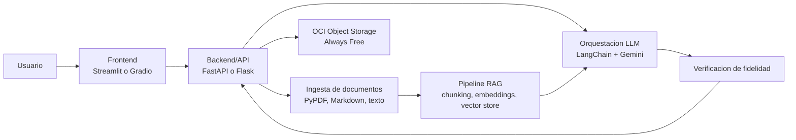

# G10-LATAM--Equipo-45
Sistema inteligente de adaptación y generación de contenido educativo con RAG y Gemini — Hackathon ONE G10-LATAM.
# NuevaMente

Sistema inteligente que ingiere documentación técnica (PDF, Markdown o texto) y la transforma automáticamente en contenido educativo personalizado, usando RAG (Retrieval-Augmented Generation) para anclar el contenido en las fuentes originales y evitar alucinaciones.

Construido para el Hackathon ONE G10-LATAM (Oracle Next Education & Alura).

## Qué resuelve

Adaptar documentación técnica densa a distintos públicos —desde alguien en transición de carrera hasta un líder técnico— es un proceso manual que consume semanas de trabajo de especialistas instruccionales. NuevaMente automatiza ese flujo: recibe un documento técnico, un perfil de destinatario y un formato pedagógico de salida, y devuelve contenido educativo estructurado y fiel a la fuente original.

## Arquitectura



## Stack

| Herramienta | Versión sugerida | Motivo |
|---|---|---|
| Python | 3.10 o superior (probado con 3.11) | El código usa sintaxis de tipos `X \| Y` (PEP 604), disponible desde 3.10 |
| FastAPI | 0.115.x | HTTP server, async-first, integra bien con Pydantic |
| Pydantic | 2.x | Validación tipada de entrada/salida del endpoint |
| LangChain | 0.3.x | Orquestación del pipeline RAG y de prompts |
| ChromaDB | última estable | Vector store para embeddings (FAISS descartado hasta que NM-02 lo confirme) |
| langchain-google-genai | última estable | LLM y embeddings de Google Gemini |
| Streamlit o Gradio | última estable | Interfaz interactiva de carga y visualización |
| oci (OCI SDK for Python) | última estable | Persistencia en OCI Object Storage, capa Always Free |
| PyPDF | última estable | Extracción de texto desde archivos PDF |

## Quickstart

```bash
# 1. Clonar y crear entorno
git clone https://github.com/<owner>/<repo>.git
cd <repo>
python3 -m venv .venv      # Python 3.10 o superior
source .venv/bin/activate        # Windows: .venv\Scripts\activate
pip install -r requirements.txt

# 2. Configurar variables de entorno
cp .env.example .env
# Editar .env — mínimo requerido: GOOGLE_API_KEY, OCI_* (config del bucket)

# 3. Verificar que todo funciona
pytest -v
```

> **Requisito:** Python 3.10 o superior. Hoy se pueden instalar las dependencias, correr `pytest`, levantar la API (sección **API**) y el frontend (sección **Frontend**).

## Configurar OCI Object Storage

Cada integrante configura sus credenciales en su propia máquina. Nada de esto se sube al repo.

1. **Crear el bucket** (consola de OCI → Storage → Buckets): nombre `nuevamente-documentos`, tier Standard, acceso privado. Anotá el *namespace* que muestra la consola en el detalle del bucket.
2. **Permisos**: una política IAM que le dé al grupo `nuevamente-backend` acceso a los objetos del bucket, y tu usuario dentro de ese grupo.
3. **Generar la API key** (Perfil → tu usuario → API keys → Add API key → Generate API key pair). Descargá la clave privada (`.pem`), guardala en `~/.oci/` y restringí permisos: `chmod 600 ~/.oci/<tu_clave>.pem`. La consola te muestra un bloque de configuración: copialo.
4. **Crear `~/.oci/config`** pegando ese bloque y ajustando `key_file` a la ruta real del `.pem`:

   ```ini
   [DEFAULT]
   user=ocid1.user.oc1..<tu_ocid>
   fingerprint=<fingerprint_de_tu_api_key>
   tenancy=ocid1.tenancy.oc1..<tu_ocid>
   region=<tu_region>
   key_file=~/.oci/<tu_clave>.pem
   ```

5. **Completar las variables en el `.env`**: `OCI_BUCKET_NAME`, `OCI_NAMESPACE`, `OCI_REGION` y, si usás otro perfil que no sea `[DEFAULT]`, `OCI_CONFIG_PROFILE`.
6. **Verificar con el smoke test** (sube, descarga, lista y borra un objeto `smoke/<timestamp>.txt`):

   ```bash
   python scripts/smoke_oci.py
   ```

   Sale con código 0 si todo anduvo, 1 si falló algún paso (imprime la causa probable: 401 credenciales, 403 política IAM, 404 bucket o namespace) y 2 si falta configuración.

**Fallback a disco local.** Si OCI no está configurado (variables `OCI_*` vacías o sin `~/.oci/config`) o la subida falla (401/403/404, red, timeout), `Almacenamiento` guarda el archivo en `ALMACENAMIENTO_LOCAL_PATH` (por defecto `./data/almacenamiento_local`, ignorada por git) con el mismo `objeto_id` que habría tenido en el bucket, registra un warning con la causa y devuelve `status_upload: "pendiente_oci"`. El pipeline sigue funcionando sin bucket; si también falla el disco, se lanza `ErrorDeAlmacenamiento`. Todavía no existe el script que sube a OCI lo que quedó pendiente.

> **Seguridad:** `~/.oci/` y los archivos `.pem` viven fuera del repo y nunca se commitean (`.gitignore` ya ignora `.oci/` y `*.pem`). Nunca pegues el contenido de la clave privada en un chat, issue o commit.
>
> **macOS:** no abras el `.pem` con doble clic. Keychain Access lo interpreta como un certificado y lo agrega al llavero del sistema por error. Si necesitás ver su contenido, usá la terminal (`cat`) o un editor de texto.

## API

Backend FastAPI (NM-06, NM-18, NM-19). Los endpoints son funciones síncronas porque las librerías del pipeline (Chroma, SDK de OCI, Gemini) son bloqueantes.

```bash
uvicorn app.api.main:app --reload     # http://127.0.0.1:8000  (documentación interactiva en /docs)
```

Importar la app no requiere claves ni red: Gemini, Chroma y OCI se inicializan en la primera solicitud real. Con `OCI_*` sin configurar, los archivos se guardan en disco y la respuesta informa `pendiente_oci`.

### Endpoints

- `GET /health` → `{"status": "ok"}` (no toca servicios externos).
- `POST /api/v1/adaptar` (`multipart/form-data`):

| Campo | Obligatorio | Descripción |
|---|---|---|
| `archivo` | uno de los dos | `.pdf`, `.md` o `.txt` (límite `MAX_UPLOAD_MB`, 10 por defecto) |
| `documento_contenido` | uno de los dos | texto del documento; no combinar con `archivo` |
| `perfil_destinatario` | sí | `Principiante` o `Lider Tecnico / Arquitecto` |
| `formato_salida` | sí | `Flashcards` o `Guia Practica Paso a Paso` |
| `documento_titulo` | no | máx. 200 caracteres; por defecto el nombre del archivo o `documento` |
| `nicho_sector`, `nivel_detalle` | no | se aceptan y se devuelven en `metadatos`, pero **hoy no influyen en el contenido generado** |

```bash
# Con archivo
curl -X POST http://127.0.0.1:8000/api/v1/adaptar \
  -F "archivo=@manual.pdf" \
  -F "perfil_destinatario=Principiante" \
  -F "formato_salida=Flashcards"

# Con texto
curl -X POST http://127.0.0.1:8000/api/v1/adaptar \
  -F "documento_contenido=Una VCN es una red privada dentro de OCI..." \
  -F "documento_titulo=Introducción a las VCN" \
  -F "perfil_destinatario=Lider Tecnico / Arquitecto" \
  -F "formato_salida=Guia Practica Paso a Paso"
```

### Respuesta de éxito (200)

```json
{
  "status": "ok",
  "metadatos": {
    "documento_titulo": "Introducción a las VCN", "perfil_destinatario": "Principiante",
    "formato_salida": "Flashcards", "nombre_archivo": "manual.pdf", "fragmentos_usados": 3,
    "nicho_sector": null, "nivel_detalle": null,
    "fecha_generacion": "2026-10-24T15:30:00Z", "modelo": "gemini-3.5-flash"
  },
  "contenido_adaptado": [{"pregunta": "¿Qué es una VCN?", "respuesta": "..."}],
  "evaluacion_calidad": {
    "anclaje_fuente_score": 0.83, "baja_confianza": false, "umbral": 0.72,
    "motivo": null, "claridad_pedagogica": null
  },
  "almacenamiento_oci": {
    "documento_original": {"bucket": "nuevamente-documentos", "objeto_id": "documentos/...", "status_upload": "exito"},
    "salida_json": {"bucket": "nuevamente-documentos", "objeto_id": "salidas/...", "status_upload": "exito"}
  }
}
```

- Para `Guia Practica Paso a Paso`, `contenido_adaptado` es `{"pasos": [{"titulo": "...", "detalle": "..."}]}`.
- `anclaje_fuente_score` mide **anclaje temático** a los fragmentos recuperados, **no veracidad**: detecta contenido fuera de tema, pero un dato inventado sobre el mismo tema puede puntuar alto. Una `baja_confianza: true` es una advertencia, no bloquea la respuesta. Si no se pudo verificar, `anclaje_fuente_score` es `null` y `motivo` lo explica.
- `claridad_pedagogica` siempre es `null` (no está implementada).
- `status_upload` puede ser `exito`, `pendiente_oci` (guardado en disco, ver más arriba) o `error`; una caída de OCI no hace fallar la solicitud. La respuesta nunca incluye rutas del servidor (la ruta del fallback local solo se registra en el log).

### Respuesta de error

Todos los errores tienen la misma forma, con mensajes en español y sin detalles internos (esos van al log):

```json
{
  "status": "error",
  "codigo": "entrada_invalida",
  "mensaje": "Revisá los datos enviados: hay campos con problemas.",
  "detalles": [{"campo": "perfil_destinatario", "problema": "Valor no permitido. Valores válidos: ..."}]
}
```

| HTTP | `codigo` | Cuándo |
|---|---|---|
| 422 | `entrada_invalida`, `documento_ilegible`, `documento_sin_texto`, `documento_sin_contenido_util`, `documento_muy_corto` | campo inválido o faltante, ni/ambos archivo y texto, extensión no soportada, archivo vacío, PDF corrupto o escaneado sin texto, texto sin contenido útil (letras < 40 % de los caracteres no blancos, o menos de 50 letras) o con menos de `MIN_CHARS_DOCUMENTO` caracteres (200 por defecto). Se rechaza antes de subir a OCI y de llamar a Gemini; la UI no ofrece "Reintentar" en los 4xx |
| 413 | `documento_demasiado_grande` | el archivo o el texto supera `MAX_UPLOAD_MB` |
| 502 | `respuesta_invalida_del_modelo` | Gemini no devolvió un JSON válido ni tras el reintento |
| 503 | `servicio_no_disponible` | falla de Gemini (generación o embeddings): cuota, red, clave |
| 500 | `error_interno` | fallo de almacenamiento o cualquier error inesperado |

Smoke test manual (una sola solicitud real, gasta cuota de Gemini): `python scripts/smoke_endpoint.py`.

### Logs, tiempos máximos y diagnóstico de cuelgues

**Logs.** Al arrancar, la app instala un handler a stdout en el logger `app` (se ve bajo `uvicorn`). Nivel con `LOG_LEVEL` (`DEBUG`, `INFO`, `WARNING`, `ERROR`; por defecto `INFO`). Cada paso de una solicitud deja `paso=<nombre> inicio` y `paso=<nombre> ok duracion=1.23s`; si falla, `paso=<nombre> FALLÓ duracion=... error=<TipoDeExcepcion>`. Pasos: `inicializar_dependencias` (solo la primera solicitud), `guardar_entrada`, `ingesta`, `subida_original`, `indexacion`, `busqueda`, `generacion`, `limpieza`, `fidelidad`, `subida_json`. No se registra contenido del documento, nombre de archivo ni claves. También se ven los reintentos de la librería de Gemini (WARNING).

**Tiempos máximos** (segundos; un timeout termina en un error normalizado y el manejo de errores lo mapea):

| Variable | Por defecto | Qué acota | Si vence |
|---|---|---|---|
| `GEMINI_TIMEOUT_S` | 45 | cada solicitud a Gemini (deadline gRPC) | `ErrorDeLLM` → 503 |
| `GEMINI_TIMEOUT_TOTAL_S` | 100 | toda la generación, reintentos de la librería incluidos | `ErrorDeLLM` → 503 |
| `EMBEDDINGS_TIMEOUT_S` | 60 | cada llamada de embeddings | `ErrorDeEmbeddings` → 503 (en la fidelidad: 200 degradado) |
| `OCI_CONNECT_TIMEOUT_S` / `OCI_READ_TIMEOUT_S` | 5 / 30 | conexión y lectura del cliente de OCI | fallback a disco local (`pendiente_oci`) |

Reintentos de Gemini: la librería (`langchain-google-genai` 2.0.6) hace como mucho 2 intentos por llamada con espera de 1-60 s, ante cualquier error de la API (un 429 incluido); eso no es configurable. Los parámetros `timeout`/`max_retries` del constructor se ignoran en la ruta síncrona, por eso el plazo se pasa en cada llamada, junto con `retry=None` para anular el reintento del cliente gRPC (que ante un 503 insistía hasta 600 s). Además, si el modelo devuelve JSON inválido, el orquestador reintenta una vez (otra llamada).

**Modelos de Gemini y respaldos.** Medido: `gemini-3.5-flash` responde en ~2 s; `gemini-3.8-flash` tarda ~37 s o falla con 503; algunos modelos listados devuelven 404 ("no longer available to new users"). Por eso la generación usa una cadena `GEMINI_MODEL` + `GEMINI_MODEL_FALLBACKS`:

| Variable | Por defecto | Qué hace |
|---|---|---|
| `GEMINI_MODEL` | `gemini-3.5-flash` | modelo principal |
| `GEMINI_MODEL_FALLBACKS` | `gemini-3.8-flash,gemini-3.5-flash-lite` | respaldos en orden, separados por coma; vacía = sin respaldos. Se ignoran espacios, duplicados y el prefijo `models/` |
| `GEMINI_BACKOFF_S` | 2 | espera antes de pasar al siguiente modelo (no tras un 404) |

Pasan al siguiente modelo: 503, 504/deadline, 429, 404 y el tope de reloj de la llamada (`GEMINI_TIMEOUT_S` + 5 s). No cambian de modelo: credenciales o pedido inválidos (400/401/403), bugs propios, respuesta vacía y JSON inválido (ese tiene su reintento, que sigue con el modelo que respondió). Todo respeta `GEMINI_TIMEOUT_TOTAL_S`: al agotarse no se prueban más modelos. Si fallan todos, la API responde el mismo 503 de siempre; el log lista cada modelo y el tipo de su error. `metadatos.modelo` informa el modelo que realmente respondió. Ejemplo de log:

```
2026-10-24 15:30:01 INFO    app.api.servicio: paso=generacion inicio
2026-10-24 15:30:03 WARNING app.llm.gemini_client: paso=generacion modelo=gemini-3.5-flash intento=1 fallo=ServiceUnavailable pasando_a=gemini-3.8-flash
2026-10-24 15:30:07 INFO    app.llm.gemini_client: paso=generacion modelo_usado=gemini-3.8-flash intentos=2
```

Nota: la librería reintenta una vez por su cuenta cada llamada (también un 404, ~2 s), antes de que se pase al siguiente modelo.

**Diagnóstico.** Si una solicitud se cuelga, `python scripts/diagnostico_pasos.py [limite_chroma] [limite_embedding] [limite_oci] [limite_gemini]` prueba por separado y con cronómetro: Chroma, un embedding, subir/descargar/borrar un archivo en OCI (sin fallback local) y UNA llamada a Gemini. Imprime OK / FALLÓ / TIMEOUT con la duración de cada paso y cuál es el sospechoso. Necesita `.env` y `~/.oci/config`. Salida: 0 todo OK, 1 algún FALLÓ, 2 algún TIMEOUT.

## Frontend

Interfaz Streamlit (NM-25, NM-26, NM-27) que consume `POST /api/v1/adaptar`. Necesita la API levantada.

```bash
uvicorn app.api.main:app --reload     # terminal 1: backend en http://127.0.0.1:8000
streamlit run frontend/app.py         # terminal 2: frontend en http://localhost:8501
```

| Variable | Por defecto | Qué hace |
|---|---|---|
| `API_BASE_URL` | `http://127.0.0.1:8000` | URL base de la API |
| `API_TIMEOUT_S` | 150 | plazo de la solicitud; debe superar el peor caso del backend (~100 s) |
| `APP_TIMEZONE` | `America/Asuncion` | zona IANA con la que se muestra la fecha de generación; si es inválida se muestra en UTC y la etiqueta lo dice |
| `MAX_UPLOAD_MB`, `EXTENSIONES_PERMITIDAS` | 10, `.pdf,.md,.txt` | los mismos del backend: la UI valida con ellos antes de enviar |

Se leen del entorno o del `.env` de la raíz. Qué hace la interfaz:

- **Diseño:** encabezado oscuro, entrada a la izquierda (tarjetas "1 · Material fuente" y "2 · Perfil y formato") y resultado a la derecha; en pantallas angostas las columnas se apilan. Perfil y formato son desplegables (`st.selectbox`); la vista legible / JSON usa `st.segmented_control`. Todo el CSS está en `frontend/estilos.py` (una sola función lo inyecta), los bloques HTML en `frontend/componentes.py` y el tema en `.streamlit/config.toml` (magenta `#CA00CA`, violeta de marca `#5D0F85`). Las fuentes (Poppins, JetBrains Mono) se piden a Google Fonts; sin conexión se usa la fuente del sistema.
- **Carga:** subir un archivo (PDF, Markdown o texto) o pegar el texto (con contador de caracteres); perfil y formato con etiquetas amigables que se envían con los valores exactos del enum del backend. `nicho_sector` y `nivel_detalle` no se muestran porque hoy no influyen en el contenido.
- **Resultado:** tarjeta de score (anclaje a la fuente, umbral, barra y píldora "Confianza normal" / "Baja confianza"; "No disponible" si el score es `null`; el puntaje mide anclaje temático, no veracidad); contenido como tarjetas (flashcards con la respuesta en un desplegable, o pasos numerados) o, con la vista **JSON**, la respuesta cruda con botón de descarga; y un desplegable "Detalles de la generación" (modelo, fragmentos, fecha en `APP_TIMEZONE`, estado de OCI).
- **Errores:** API caída, timeout, 4xx (se muestra el mensaje del formato de error de la API) y 5xx se muestran en una tarjeta de error, nunca como stack traces. Después de un error, **Reintentar** conserva lo cargado. El botón se deshabilita mientras se genera.

El cliente HTTP (`frontend/cliente_api.py`) y la lógica de formato (`frontend/formato.py`) no dependen de Streamlit y están cubiertos por `tests/test_frontend.py`.

## Próximamente (aún no implementado)

Este comando apunta a un archivo que todavía no existe en el repo (`scripts/ingest.py`):

```bash
python scripts/ingest.py          # CLI de ingesta de docs/
```

## Contrato del endpoint principal

El contrato vigente es el de la sección **API** (`POST /api/v1/adaptar`, definido en `app/api/schemas.py`). Los valores de `perfil_destinatario` y `formato_salida` están limitados a los definidos en `app/llm/prompts.py`, no aceptan texto libre.

## Checklist del MVP

- [ ] Ingesta funcional de documentos técnicos (PDF, Markdown o texto)
- [ ] Pipeline de RAG con chunking, embeddings y búsqueda vectorial
- [ ] Orquestación con Gemini vía LangChain
- [ ] Adaptación funcionando para 2 perfiles y 2 formatos distintos
- [ ] Salida estructurada en JSON + interfaz interactiva (Streamlit o Gradio)
- [ ] Integración activa con OCI Object Storage, capa Always Free
- [ ] Mínimo 3 ejemplos de ejecución con documentos reales o simulados
- [ ] Documentación completa con diagrama de arquitectura

## Actualizar documentos de referencia

Pendiente: depende de `scripts/ingest.py` y del backend (ver "Próximamente (aún no implementado)").

## Despliegue

- **Frontend/Backend:** Streamlit Community Cloud, Render o una instancia OCI Compute (Always Free) si el equipo decide priorizarlo en la semana 4.
- **Almacenamiento:** OCI Object Storage, capa Always Free, es obligatorio independientemente de dónde corra la app — así lo exige el checklist del hackathon.

## Estructura del proyecto

```
nuevamente/
├── app/
│   ├── api/                      # Backend FastAPI (main, schemas, errores, servicio, dependencias)
│   ├── config.py                 # Settings (pydantic-settings + .env)
│   ├── ingesta/
│   │   ├── pdf_loader.py         # Extracción de texto desde PDF (PyPDF)
│   │   └── text_loader.py        # Lectura de Markdown/texto plano
│   ├── rag/
│   │   ├── chunking.py           # Segmentación del texto
│   │   ├── embeddings.py         # Generación de embeddings
│   │   └── vector_store.py       # Abstracción Chroma/FAISS
│   ├── llm/
│   │   ├── prompts.py            # Prompts por perfil y formato
│   │   ├── orquestacion.py       # Cadena LangChain + Gemini
│   │   └── verificacion.py       # Chequeo de fidelidad y metadatos
│   └── oci/
│       └── storage.py            # Subida/lectura en OCI Object Storage
├── frontend/
│   ├── app.py                    # Interfaz Streamlit
│   ├── cliente_api.py            # Cliente HTTP de la API (sin Streamlit)
│   ├── formato.py                # Opciones, validación y formateo del resultado
│   ├── componentes.py            # Bloques HTML (funciones puras)
│   ├── estilos.py                # CSS de la interfaz
│   └── config.py                 # API_BASE_URL, API_TIMEOUT_S, límites
├── docs/                         # Documentos fuente para indexar
├── scripts/
│   └── ingest.py                 # CLI de ingesta
├── tests/                        # Test plan y casos automatizados (QA)
├── requirements.txt
└── .env.example
```

## Equipo — G10-LATAM-equipo 45

| Nombre | Rol |
|---|---|
| Jessica Escobar | QA Engineer |
| Larissa Cabrera | Full Stack Developer |
