# Arquitectura y flujo RAG

Este documento describe el recorrido de una solicitud a `POST /api/v1/adaptar`, con los nombres de paso que aparecen en los logs (`paso=<nombre> inicio` / `ok duracion=...`). Todo está tomado de `app/api/servicio.py`, `app/ingesta/subida.py`, `app/llm/orquestador.py` y los módulos que estos usan.

## Diagrama

```mermaid
flowchart LR
  U["Usuario<br/>Streamlit"] -->|"POST /api/v1/adaptar"| A["API FastAPI"]
  A --> V{"Validación de la solicitud<br/>campos, extensión, tamaño"}
  V -->|"422 / 413"| E["Error claro<br/>sin llamar al LLM"]
  V -->|"válida"| I["Ingesta<br/>PDF / MD / TXT"]
  I --> VC{"Contenido útil<br/>letras y largo mínimo"}
  VC -->|"422"| E
  VC -->|"válido"| O1[("OCI Object Storage<br/>documento original")]
  O1 --> C["Chunking<br/>800 + overlap 120"]
  C --> EM["Embeddings<br/>gemini-embedding-001"]
  EM --> DB[("ChromaDB")]
  DB --> R["Recuperación top_k=8"]
  R --> P["Prompt por perfil x formato"]
  P --> G["Gemini<br/>cadena de modelos con fallback"]
  G --> J["Validación del JSON<br/>1 reintento si es inválido"]
  J --> F["Fidelidad<br/>similitud coseno, umbral 0.72"]
  F --> O2[("OCI Object Storage<br/>resultado JSON")]
  O2 --> RESP["Respuesta<br/>contenido + puntaje + metadatos"]
  RESP --> U
```

## Parámetros

| Parámetro | Valor por defecto | Dónde se define |
|---|---|---|
| `CHUNK_SIZE` | 800 caracteres | `.env` / `app/config.py` |
| `CHUNK_OVERLAP` | 120 caracteres | ídem |
| `TOP_K_RECUPERACION` | 8 fragmentos | ídem |
| `UMBRAL_ANCLAJE` | 0.72 | ídem |
| `GEMINI_EMBEDDING_MODEL` | `models/gemini-embedding-001` | ídem |
| `MAX_UPLOAD_MB` / `MIN_CHARS_DOCUMENTO` | 10 / 200 | ídem |

El chunk final puede medir hasta `CHUNK_SIZE + CHUNK_OVERLAP`, porque el solapamiento se antepone al fragmento.

## Flujo paso por paso

### 0. Validación de la solicitud (antes de los pasos con log)

- **Qué hace:** FastAPI y `SolicitudAdaptacion` (`app/api/schemas.py`) validan que los enums de perfil y formato sean válidos, que haya exactamente uno entre `archivo` y `documento_contenido`, que la extensión esté permitida y que el archivo no esté vacío; `app/api/main.py` rechaza con 413 lo que supera `MAX_UPLOAD_MB`.
- **Decisión:** rechazar en la entrada con un error claro (422/413) antes de gastar cuota de Gemini o espacio en OCI.

### 1. `guardar_entrada`

- **Qué hace:** escribe la entrada (archivo o texto pegado) en una carpeta temporal, con el nombre saneado del original y solo la extensión ya validada.
- **Decisión:** reutilizar los loaders, que leen de disco, y no usar nunca el nombre del usuario como ruta.

### 2. `ingesta`

- **Qué hace:** extrae el texto con `cargar_pdf` (pypdf) o `cargar_texto` (Markdown / texto, UTF-8).
- **Errores:** PDF corrupto o extensión no soportada → `ErrorDeIngesta` → 422 `documento_ilegible`. Si el documento no tiene texto (por ejemplo un PDF escaneado) → 422 `documento_sin_texto`.
- **Decisión:** ingerir **antes** de subir: un archivo corrupto o sin texto no se guarda en el bucket.

### Validación de contenido (entre `ingesta` y `subida_original`)

- **Qué hace:** `app/ingesta/validacion.py` normaliza los espacios y aplica, en orden: (1) letras / caracteres no blancos < 0.4 → `documento_sin_contenido_util`; (2) menos de 50 letras (o de `MIN_CHARS_DOCUMENTO`, si es menor) → `documento_sin_contenido_util`; (3) menos de `MIN_CHARS_DOCUMENTO` caracteres → `documento_muy_corto`.
- **Decisión:** un texto de solo símbolos o de pocas palabras no da una adaptación confiable y reintentar no cambia el resultado; se rechaza con 422 antes de subir el original y de llamar al LLM.

### 3. `subida_original`

- **Qué hace:** sube el documento original a OCI Object Storage.
- **Decisión:** si OCI no está configurado o falla, se guarda en disco local y se informa `status_upload: "pendiente_oci"`; la solicitud no falla (solo falla si también falla el disco: 500).

### 4. `indexacion`

- **Qué hace:** el orquestador divide el texto en chunks (`app/rag/chunking.py`: separador recursivo párrafo → línea → oración → espacio → carácter, con solapamiento), genera sus embeddings con `gemini-embedding-001` y los agrega a ChromaDB (`PersistentClient`, colección con métrica coseno). El log agrega `indexacion: <n> chunks`.
- **Decisión:** cada solicitud indexa el documento bajo una clave propia (`<uuid corto>-<nombre saneado>`), para que dos solicitudes simultáneas no se pisen los fragmentos.

### 5. `busqueda`

- **Qué hace:** embebe la consulta `"<título>. conceptos principales y puntos clave del documento"` y recupera los `TOP_K_RECUPERACION` (8) fragmentos más cercanos, filtrando por la clave del documento. Luego los reordena por su posición original en el documento.
- **Decisión:** el usuario no hace una pregunta concreta, así que se busca lo más representativo del tema. Reordenar por posición hace que una guía paso a paso conserve la secuencia del documento. Mandar solo los fragmentos recuperados, y no el documento entero, acota el prompt aunque el documento sea largo.

### 6. `generacion`

- **Qué hace:** arma el prompt de sistema según perfil y formato (`app/llm/prompts.py`) y el prompt de usuario con título y fragmentos, y llama a Gemini a través de `ClienteGemini` (temperatura 0.2). Valida el JSON recibido: para Flashcards cada ítem necesita `pregunta` y `respuesta`; para la guía, `titulo` y `detalle`. Si el JSON no es válido, reintenta una vez con un recordatorio y con el modelo que ya había respondido.
- **Errores:** JSON inválido también en el reintento → 502 `respuesta_invalida_del_modelo`; Gemini caído → 503.
- **Decisión:** cadena de modelos con respaldo ([fallback.md](fallback.md)); `metadatos.modelo` informa el que realmente respondió.

### 7. `limpieza`

- **Qué hace:** elimina del vector store el documento de esta solicitud. Se ejecuta aunque la generación haya fallado.
- **Decisión:** la API no acumula documentos entre solicitudes. Una limpieza fallida se registra pero no tapa la respuesta ni el error original.

### 8. `fidelidad`

- **Qué hace:** calcula el puntaje de anclaje a la fuente ([fidelidad.md](fidelidad.md)).
- **Decisión:** si los embeddings fallan en este paso, la respuesta no se tumba: se devuelve `anclaje_fuente_score: null`, `baja_confianza: true` y el motivo "no se pudo verificar la fidelidad".

### 9. `subida_json`

- **Qué hace:** sube a OCI el resultado completo en JSON y completa `almacenamiento_oci.salida_json` en la respuesta.
- **Decisión:** el JSON subido no puede incluir su propio `objeto_id`, por eso se sube con `salida_json` en `null` y se completa después en la respuesta.

### Respuesta

`RespuestaAdaptacion`: `status`, `metadatos`, `contenido_adaptado`, `evaluacion_calidad` y `almacenamiento_oci`. Al final se registra una línea `Adaptación completada` con perfil, formato, `modelo_usado`, `intentos_modelo`, duración, estado de las subidas y `baja_confianza`.

Hay un paso más, `inicializar_dependencias`, que solo aparece en la primera solicitud: crea las dependencias (Gemini, Chroma, OCI) de forma perezosa.

## Capas y responsabilidades

| Capa | Módulos | Responsabilidad |
|---|---|---|
| API | `app/api/` | Contrato HTTP, validación de la solicitud, traducción de errores a mensajes en español |
| Ingesta | `app/ingesta/` | Lectura de PDF / MD / TXT, validación de contenido, subida del original |
| RAG | `app/rag/` | Chunking, embeddings, vector store |
| LLM | `app/llm/` | Prompts, cliente de Gemini con fallback, orquestación y fidelidad |
| Almacenamiento | `app/oci/` | OCI Object Storage con fallback a disco local |
| Transversal | `app/config.py`, `app/trazas.py`, `app/logging_config.py` | Configuración, logs por paso y topes de tiempo |
| Frontend | `frontend/` | Interfaz Streamlit; consume la API por HTTP |
